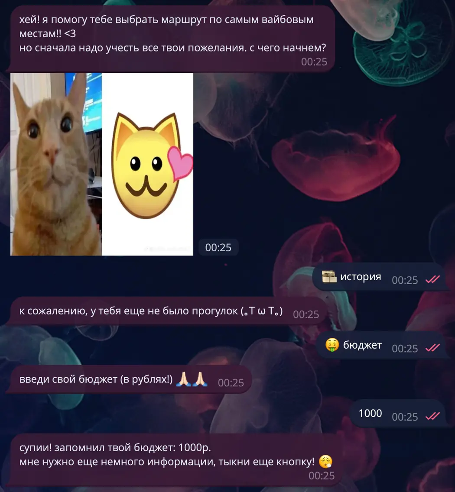
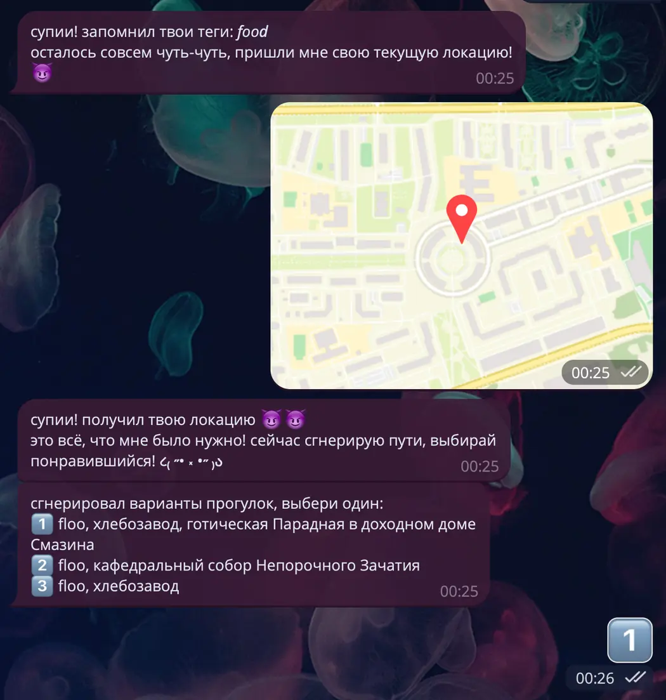
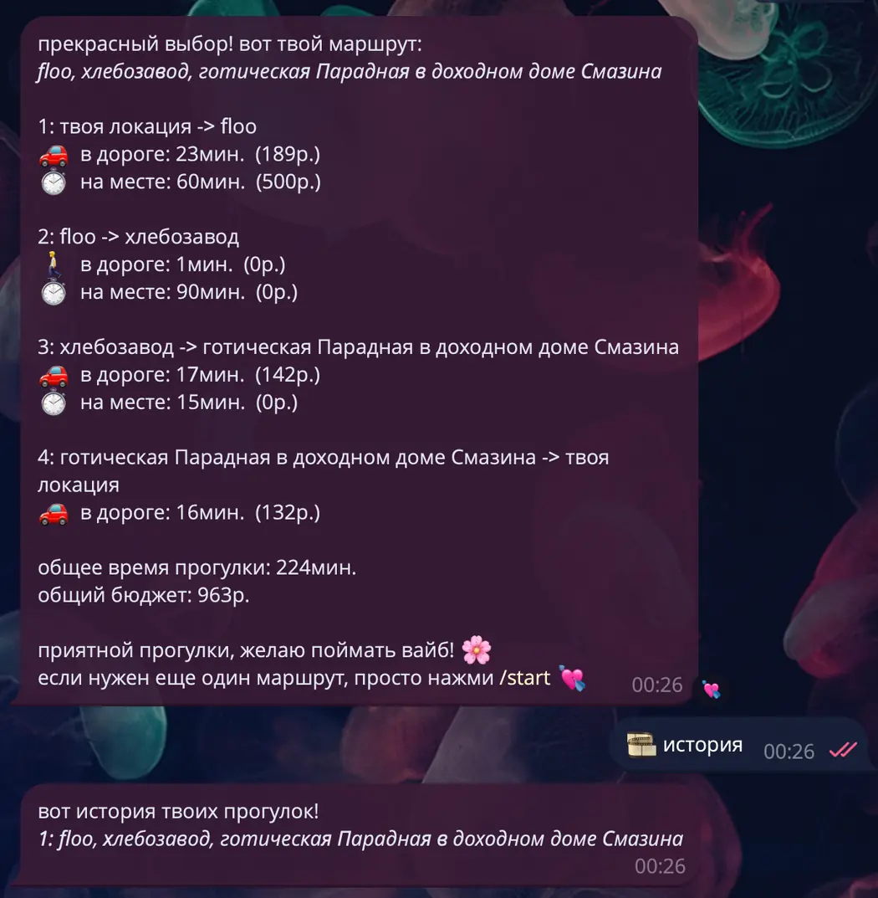

# WalkProject — Telegram Walking Route Planner

**Team project | Python · pyTelegramBotAPI · Pydantic · GraphHopper · WeatherAPI · pytest**

WalkProject is a Russian-language Telegram bot that suggests walking itineraries around **Moscow**. It asks users about their **budget**, **available time**, **interests** (e.g., parks, art or food), and **location**. It then evaluates local points of interest against opening hours, current weather, travel times and costs, generates several candidate routes, and lets the user select an itinerary.

> **Project status:** coursework / prototype. This repository preserves the original team's routing design and makes the code safer and easier to explore. It is not a continuously hosted service, and its place database and opening hours may be outdated.

## Telegram bot preview

| 1. Welcome and budget | 2. Time and interests |
|:---:|:---:|
| [](screenshots/01-welcome-and-budget.webp) | [](screenshots/02-time-and-interests.webp) |
| **3. Location and route suggestions** | **4. Itinerary details and walk history** |
| [](screenshots/03-route-options.webp) | [](screenshots/04-itinerary-and-history.webp) |

*Screenshots from the original Russian-language student prototype. The historical interface refers to "your location"; routing times and costs use a precomputed matrix referenced to central Moscow, not live routes from the user's actual starting point (see the routing design below). Click any screenshot to enlarge it.*


## Features

- Conversational Telegram flow: budget, duration, interest tags and location.
- A curated dataset of Moscow places with categories, visit durations, prices and opening hours.
- Weather-aware filtering with WeatherAPI, plus route generation and ranking.
- Precomputed travel-time matrices, walking/car travel estimates and estimated route cost.
- Multiple itinerary suggestions, detailed breakdowns and in-memory walk history.
- Unit tests for route generation, place filtering, data parsing and external-service adapters.

## Routing design: a deliberate free-tier trade-off

**The app uses a precomputed travel-time matrix referenced to the Moscow Kremlin**, instead of making fresh GraphHopper routing requests from every user's location. Recalculating many point-to-point travel times on the free API tier was slow and consumed too much API quota.

This **reduces latency and API usage** but means the displayed travel times and costs are **approximate** and the itinerary's start/end are modeled around **central Moscow, not the user's exact position**. User location is still used to request local weather. This behavior is an intentional prototype design decision, not precise door-to-door routing. The experimental per-user matrix calculation is retained in `utils/travel_time.py`, but is not used by the default bot flow.

## Project structure

| Path | Purpose |
| --- | --- |
| `bot.py` | Telegram bot entry point and handler registration |
| `handlers/` | Conversation flow, route delivery and walk history |
| `core/` | Route generation, filtering and scoring |
| `data/` | Curated places and cached travel-time matrices |
| `services/` | WeatherAPI and GraphHopper integration helpers |
| `utils/` | Weather selection, travel times, sorting and time conversion |
| `keyboards/`, `utils_bot/` | Telegram UI and temporary session storage |
| `tests/` | Tests for main algorithms, utilities and services |

## Run locally

**Requirements:** Python 3.10+ and a Telegram bot token; WeatherAPI is needed for real weather requests. These external services are not necessary for running the unit tests.

```bash
python3 -m venv .venv
source .venv/bin/activate        # Windows: .venv\Scripts\activate
python -m pip install -r requirements.txt
cp .env.example .env
```

Edit `.env` and set `TELEGRAM_TOKEN` and `WEATHERAPI_KEY` to **your own** credentials. `GRAPHOPPER_API_KEY` and `TRAVEL_TIME_API_KEY` are optional for experimental travel-time recomputation; the default bot uses the precomputed matrix.

```bash
python -m bot
```

Open your Telegram bot, send `/start`, and follow its prompts to enter a budget, walking time, tags and location. The bot generates route options and lets you choose one. Location must be shared for weather lookup; it **does not** change the cached routing matrix.

The app stores user preferences and route history **in process memory only**, so those are reset when the bot stops. No production deployment or persistent database is included.

## Tests

```bash
python -m pytest -q
```

Tests cover the core route generator, evaluation/filtering, parsing, weather and routing services (with mocked API responses), and utilities. They do **not** prove that a live Telegram deployment or external API accounts currently work.

## Team and contributions

Originally developed as a team project by:

- **Margarita Trott:** Telegram bot interaction / user-facing flow, place selection and testing.
- **Timofey Karyagin:** backend and code style.

The route algorithms and code are preserved as coursework rather than presented as a newly rewritten production system. An updated README and minor safety/robustness adjustments were added for portfolio publication.

## Security and limitations

- **Never commit `.env` or API tokens.** Copy `.env.example` to `.env` locally. If credentials were committed to the old GitLab branch/history, **revoke/rotate them before sharing**; deleting a file in a later commit does not remove it from history.
- The Moscow places, opening hours, costs and weather service dependencies are historical and may be outdated.
- The precomputed reference matrix intentionally trades personalized start-point accuracy for fewer API requests.
- Some edge cases (network failures, user input validation) remain typical of a student prototype.

**Original source:** [GitLab WalkProject](https://gitlab.com/Fu22210/walkproject) (`dev` branch). The GitLab project is retained as the historical source; this copy is prepared for a separate, clean GitHub repository.
